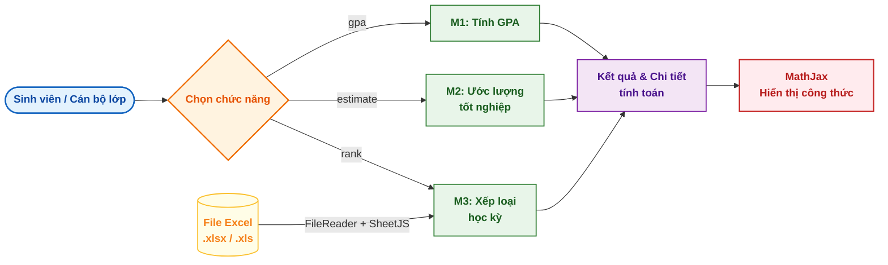
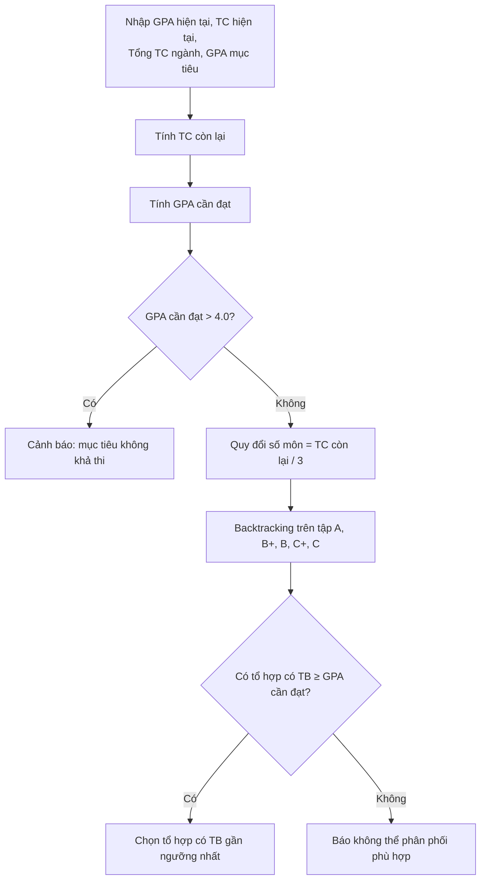

## Website phân tích GPA (Grade Point Average) áp dụng tại Đại học Cần Thơ (CTU)

**Sinh viên thực hiện:** Huỳnh Thanh Phong  - Khoa học máy tính, Trường Công nghệ thông tin và Truyền thông, Đại học Cần Thơ

---

## 1. Tóm tắt

Kết quả học tập thường chỉ được thông báo dưới dạng một con số cuối cùng, trong khi sinh viên cần hiểu *con số đó hình thành thế nào*, *cần đạt bao nhiêu ở các kỳ còn lại*, và cán bộ lớp cần *xếp loại cả danh sách* một cách nhất quán. Dự án giải quyết ba nhu cầu này bằng ba module độc lập trong một giao diện duy nhất.

| Module | Câu hỏi giải quyết | Đầu vào | Đầu ra |
|---|---|---|---|
| **M1 – Tính GPA** | GPA học kỳ của tôi là bao nhiêu và được tính ra sao? | Điểm hệ 10, số tín chỉ từng môn | GPA hệ 4.0 + bảng chi tiết từng môn + công thức |
| **M2 – Ước lượng tốt nghiệp** | Tôi cần đạt GPA bao nhiêu ở phần còn lại để tới mục tiêu? | GPA hiện tại, tín chỉ đã tích lũy, tổng tín chỉ ngành, GPA mục tiêu | GPA cần đạt + gợi ý phân phối điểm chữ |
| **M3 – Xếp loại học kỳ** | Cả danh sách này được xếp loại và xếp hạng thế nào? | File Excel (GPA, điểm rèn luyện, tín chỉ đăng ký) | Bảng đã xếp loại và sắp xếp thứ hạng |

| Thông tin | Chi tiết |
|---|---|
| Kiến trúc | Client-side thuần, không máy chủ, không cơ sở dữ liệu |
| Công nghệ | HTML, JavaScript, Bootstrap 5.3, SheetJS (đọc Excel), MathJax 3 (hiển thị công thức) |
| Cách chạy | Mở `index.html` bằng trình duyệt |
| Cấu trúc mã | `index.html` (giao diện + hướng dẫn) · `web.js` (logic 3 module) · `Demo.png` (mẫu file Excel) |

---

## 2. Phương pháp

### 2.1 Kiến trúc hệ thống

Toàn bộ xử lý diễn ra trong trình duyệt; file Excel được đọc cục bộ bằng `FileReader`, không gửi đi đâu.

### 2.2 Quy đổi điểm (dùng chung cho M1 và M2)

```mermaid
flowchart LR
    %% Phong cách màu sắc phân cấp học tập
    classDef rankA fill:#E8F5E9,stroke:#2E7D32,stroke-width:2px,color:#1B5E20,font-weight:bold;
    classDef rankB fill:#E3F2FD,stroke:#1565C0,stroke-width:1.5px,color:#0D47A1,font-weight:bold;
    classDef rankC fill:#FFFDE7,stroke:#FBC02D,stroke-width:1.5px,color:#F57F17,font-weight:bold;
    classDef rankD fill:#FFF3E0,stroke:#EF6C00,stroke-width:1.5px,color:#E65100,font-weight:bold;
    classDef rankF fill:#FFEBEE,stroke:#C62828,stroke-width:2px,color:#B71C1C,font-weight:bold;

    %% Các khối thang điểm
    A["Điểm A<br/>≥ 9.0 · Hệ 4.0"]:::rankA
    BP["Điểm B+<br/>≥ 8.0 · Hệ 3.5"]:::rankB
    B["Điểm B<br/>≥ 7.0 · Hệ 3.0"]:::rankB
    CP["Điểm C+<br/>≥ 6.5 · Hệ 2.5"]:::rankC
    C["Điểm C<br/>≥ 5.5 · Hệ 2.0"]:::rankC
    DP["Điểm D+<br/>≥ 5.0 · Hệ 1.5"]:::rankD
    D["Điểm D<br/>≥ 4.0 · Hệ 1.0"]:::rankD
    F["Điểm F<br/>&lt; 4.0 · Hệ 0.0"]:::rankF

    %% Luồng liên kết ngang
    A --> BP --> B --> CP --> C --> DP --> D --> F
```

### 2.3 M1 – Tính GPA học kỳ

$$
\text{GPA} = \frac{\sum_{i=1}^{n} (x_i \times c_i)}{\sum_{i=1}^{n} c_i}
$$

với $x_i$ là điểm hệ 4.0 và $c_i$ là số tín chỉ của môn $i$. Môn điểm **F** bị loại khỏi cả tử số và mẫu số theo quy ước của công cụ.

### 2.4 M2 – Ước lượng GPA tốt nghiệp (bài toán nghịch)

$$
\text{GPA}_{cần} = \frac{G_{mt} \times C_{tổng} - G_{ht} \times C_{ht}}{C_{tổng} - C_{ht}}
$$

với $G_{mt}$ là GPA mục tiêu, $G_{ht}$ và $C_{ht}$ là GPA và tín chỉ hiện tại, $C_{tổng}$ là tổng tín chỉ của ngành.

| Tham số của bước gợi ý | Giá trị |
|---|---|
| Tín chỉ mỗi môn giả định | 3 |
| Tập điểm chữ được xét | A, B+, B, C+, C |
| Tiêu chí chọn | Trung bình ≥ GPA cần đạt và sát ngưỡng nhất |

### 2.5 M3 – Xếp loại và xếp hạng học kỳ

**Định dạng file Excel đầu vào** (xem `Demo.png`):

| Cột bắt buộc | Kiểu |
|---|---|
| `GPA học kỳ` | Số, thang 4.0 |
| `Điểm rèn luyện` | Số, thang 100 |
| `Số tín chỉ đăng ký` | Số nguyên |

**Ngưỡng xếp loại:**

| Mức | GPA | Điểm rèn luyện |
|---|:---:|:---:|
| Xuất sắc | ≥ 3.6 | ≥ 90 |
| Giỏi | ≥ 3.2 | ≥ 80 |
| Khá | ≥ 2.5 | ≥ 70 |
| Trung bình | ≥ 2.0 | ≥ 60 |
| Yếu | ≥ 1.0 | ≥ 50 |
| Không xét | < 1.0 | < 50 |

**Xếp loại cuối** là mức thấp hơn giữa hai tiêu chí:

$$
\text{Xếp loại} = \min(\text{Loại}_{GPA},\ \text{Loại}_{ĐRL})
$$

---

## 3. Đóng góp

| Khoảng trống thực tế | Hướng tiếp cận | Giá trị mang lại |
|---|---|---|
| GPA chỉ là một con số, khó kiểm chứng | Phơi bày toàn bộ bước trung gian | Tự kiểm chứng, hiểu tác động từng môn |
| Mục tiêu tốt nghiệp thiếu định lượng | Giải bài toán nghịch + kiểm tra khả thi | Lập kế hoạch học tập dựa trên số liệu |
| Xếp loại danh sách thủ công, dễ lệch | Quy tắc `min` + sắp xếp xác định | Kết quả nhất quán, tái lập được |
| Dữ liệu điểm mang tính cá nhân | Xử lý hoàn toàn phía client | Riêng tư, triển khai không tốn hạ tầng |

**Từ kết quả sang sự hiểu: minh bạch hóa quá trình tính GPA.** Người học thường tiếp nhận GPA như một kết quả đóng, nên khó nhận ra môn nào kéo điểm xuống hay vì sao một môn điểm F lại làm thay đổi mẫu số. M1 không chỉ xuất ra GPA mà trình bày chuỗi quy đổi điểm hệ 10, điểm chữ, hệ 4.0, tích với tín chỉ và tổng tín chỉ hiệu dụng, kèm công thức. Nhờ đó công cụ đóng vai trò *thiết bị kiểm chứng*: sinh viên đối chiếu được con số với cổng thông tin và hình dung được môn nào đáng ưu tiên cải thiện.

**Từ mô tả sang hoạch định: đảo chiều bài toán GPA.** Hầu hết công cụ tính điểm chỉ trả lời "đã đạt bao nhiêu". M2 trả lời câu hỏi mang tính quyết định hơn: "cần đạt bao nhiêu". Bằng cách giải ngược GPA cần đạt trên số tín chỉ còn lại, công cụ cho biết ngay mục tiêu có khả thi hay không (vượt 4.0 thì cảnh báo), tránh việc sinh viên theo đuổi một kỳ vọng không thể đạt. Với mục tiêu khả thi, bước tìm kiếm tổ hợp chuyển con số trừu tượng thành kế hoạch cụ thể, ví dụ cần bao nhiêu môn A, B+, B để đạt ngưỡng. Đây là bước đưa kết quả từ "đánh giá" sang "hành động".

**Từ thao tác thủ công sang quy trình nhất quán: chuẩn hóa xếp loại hàng loạt.** Việc xếp loại cho cả lớp theo hai tiêu chí độc lập (GPA và điểm rèn luyện) dễ phát sinh sai lệch khi làm tay, nhất là khi phải phân xử các trường hợp bằng điểm. M3 mã hóa quy tắc lấy mức thấp hơn giữa hai tiêu chí và áp dụng thứ tự ưu tiên bốn khóa (xếp loại, GPA, điểm rèn luyện, số tín chỉ đăng ký). Vì cùng đầu vào luôn cho cùng thứ hạng, kết quả có tính tái lập và có thể đối chiếu, phù hợp cho cán bộ lớp phục vụ xét học bổng hoặc khen thưởng.

**Giảm rào cản triển khai và bảo vệ dữ liệu.** Do toàn bộ tính toán diễn ra phía client, dữ liệu điểm và file danh sách không rời khỏi thiết bị người dùng, đồng thời hệ thống không cần máy chủ hay cơ sở dữ liệu. Các thang điểm và ngưỡng được tách thành bảng hằng số trong `web.js`, nên việc điều chỉnh theo quy chế mới chỉ là thay đổi dữ liệu thay vì viết lại logic.

---

## 4. Kết luận

Dự án chứng minh rằng ba nhu cầu phân tích GPA điển hình của sinh viên (kiểm chứng, hoạch định, xếp loại hàng loạt) có thể được đáp ứng bằng một ứng dụng web nhẹ, không phụ thuộc hạ tầng và không đưa dữ liệu ra khỏi máy người dùng. Điểm khác biệt nằm ở việc chuyển công cụ từ *máy tính điểm* sang *công cụ hỗ trợ ra quyết định*.

**Hạn chế và hướng phát triển**

| Hạn chế hiện tại | Hướng khắc phục |
|---|---|
| M2 giả định mọi môn 3 tín chỉ và chỉ xét điểm A đến C | Cho phép nhập tín chỉ từng môn, mở rộng tập điểm chữ |
| Backtracking tăng nhanh theo số môn còn lại | Thay bằng quy hoạch động hoặc cắt nhánh |
| Chưa xử lý ngoại lệ (tất cả môn F, tín chỉ còn lại ≤ 0, thiếu cột Excel) | Bổ sung kiểm tra đầu vào và thông báo lỗi |
| Bảng hướng dẫn ghi mức Khá của điểm rèn luyện là 65–79, trong khi mã dùng ngưỡng ≥ 70 | Thống nhất giữa tài liệu và mã nguồn |
| Thang điểm, ngưỡng được cài cứng | Đối chiếu quy chế hiện hành, đưa ra file cấu hình |
| Chưa có kiểm thử tự động và đánh giá thực nghiệm | Bổ sung bộ test cho các ca biên |

---

Tác giả: huynhthanhphong231004IT · Đại học Cần Thơ
